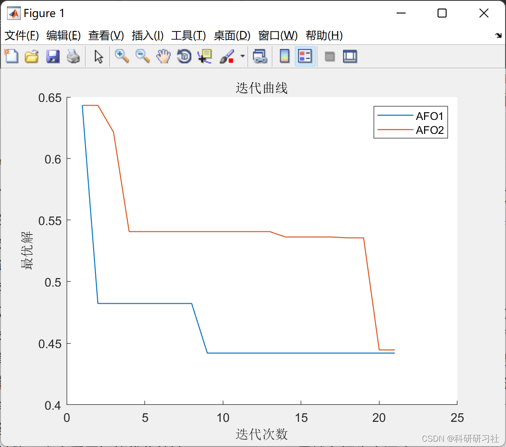
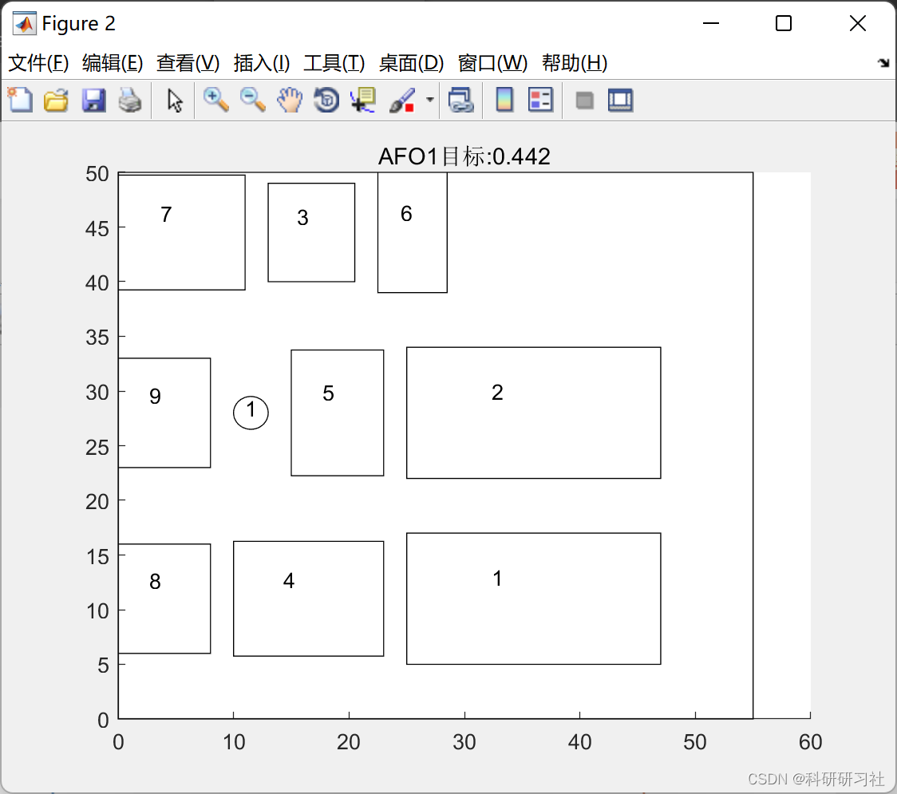

# Intelligent Optimization Algorithms PSO/GWO/AFO+ for Flexible Workshop Production Scheduling (Matlab Code Implementation)

1. Flexible workshop production scheduling
As the economic globalization deepens and market competition becomes increasingly severe, the traditional single-factory manufacturing model can no longer meet the production needs of China's manufacturing industry. The distributed manufacturing production model has become an important means for enterprises to enhance their competitiveness in production. Due to inevitable differences in technology levels, machine numbers, and material transportation between different factories, adopting effective division of labor and cooperation methods to efficiently produce high-quality products has become a current research hotspot.
The Flexible Job Shop Scheduling Problem (FJSP) is a complex NP-hard problem," breaking away from the constraints of traditional rigid mass production on equipment uniqueness, making workshop scheduling more complex and variable. From the number of scheduling objectives, flexible job shop scheduling can be divided into: single-objective and multi-objective scheduling.
Compared to single-objective scheduling problems. The multi-objective flexible job shop scheduling problem is more complex. Firstly, It is difficult to ensure the optimization balance of multiple objectives during scheduling. Secondly, The parameters and dimensions of multiple targets differ. The current research approach to multi-objective scheduling is divided into two categories. Firstly, Transform multiple objectives into a single objective through weighting. Secondly, Non-dominated solution generation method. Utilize the Pareto principle to generate an optimal solution set, which is widely applied in solving problems with more than three objectives. In algorithm design, it is necessary to improve or combine the advantages of two different algorithms to enable the algorithm to achieve better optimization results. DEB proposed the NSCA-algorithm based on NSGA. The early detection method is highly efficient.Chen et al. proposed the hybrid algorithm MGSA-NSGA-III, adopting a chaotic mutation strategy to enhance the uniformity of solution space distribution. Li et al. "Improved the reference point generation strategy and operator selection mechanism based on traditional NSGA-III, improving the computational efficiency of the algorithm. When solving high-dimensional multi-objective problems, common global intelligent algorithms all have shortcomings such as low population diversity, poor search efficiency, and easy to fall into local optima. This paper adopts intelligent optimization algorithms PSO/GWO/AFO+ flexible workshop production scheduling.
2. Running Results Editing
3. Matlab and Article Reading This article only displays a portion of the code, all code and articles can be found in:
function [bestY,bestX,recording]=PSO(x,y,option,data)\n    %% Particle Swarm Optimization Algorithm\n    %% Initialization\n    recording.bestFit=zeros(option.maxIteration+1,1);\n    recording.meanFit=zeros(option.maxIteration+1,1);\n    v=randn(size(x));\n    %% Update record\n    [y_g,position]=min(y);\n    x_g=x(position(1),:);\n    y_p=y;\n    x_p=x;\n    recording.bestFit=y_g;\n    recording.meanFit=mean(y_p);\n    %% Starting the update\n    for iter=1:option.maxIteration\n        disp(['PSO,iter:',num2str(iter),',minFit:',num2str(y_g)])\n        %% Update\n        for i=1:option.numAgent\n            v(i,:)=option.w_pso*v(i,:)+option.c1_pso*rand(size(x(1,:))).*(x_g-x(i,:))+option.c2_pso*rand(size(x(1,:))).*(x_p(i,:)-x(i,:));\n            x(i,:)=x(i,:)+v(i,:);\n            x(i,:)=checkX(x(i,:),option,data);\n            [y(i),~,x(i,:)]=option.fobj(x(i,:),option,data);\n            if y(i)<y_p(i)\n                y_p(i)=y(i);\n                x_p(i,:)=x(i,:);\n                if y_p(i)<y_g\n                    y_g=y_p(i);\n                    x_g=x_p(i,:);\n                end\n            end\n        end\n        %% Update record\n        recording.bestFit(1+iter)=y_g;\n        recording.meanFit(1+iter)=mean(y_p);\n    end\n    bestY=y_g;\n    bestX=x_g;\nend\n  
4. References

## Images

<!-- PAYMENT_BLOCK -->

## Get this dataset

- Payment link (Stripe): [Buy now](https://buy.stripe.com/3cs8yP7sY87d0vu9AB)
- Payment QR code: 

<!-- /PAYMENT_BLOCK -->
